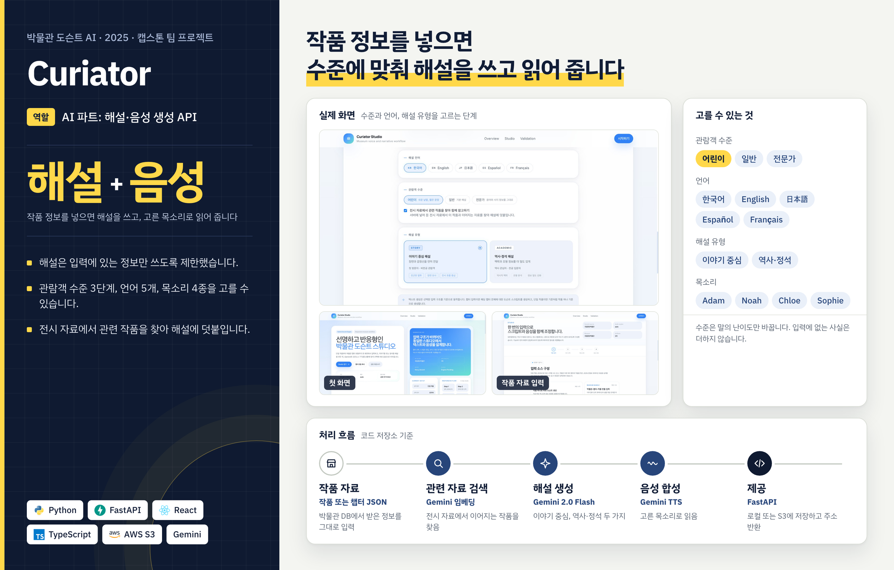
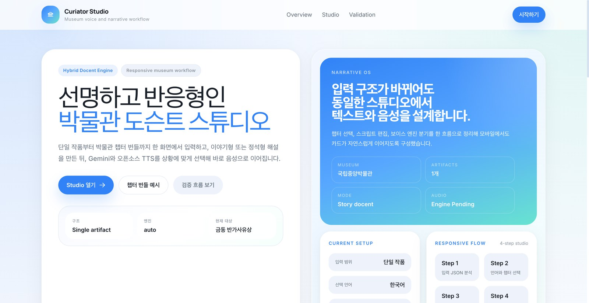
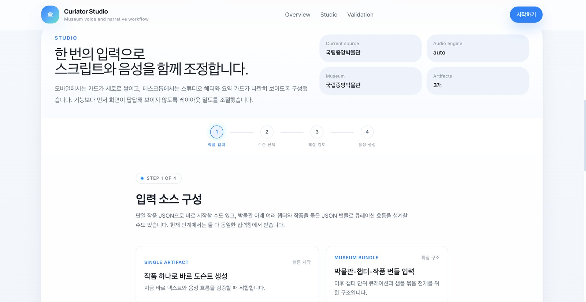
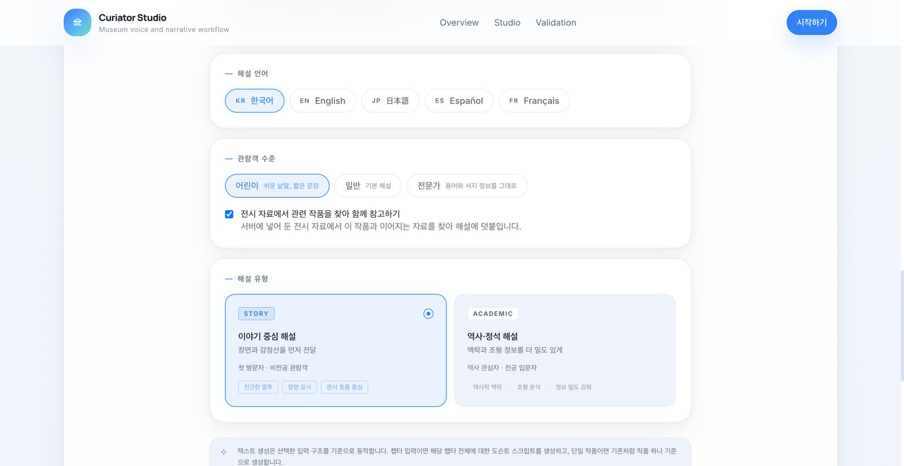
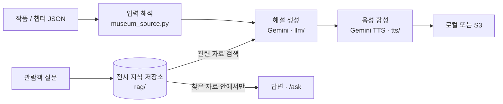

# Curiator: 박물관 도슨트 AI

작품 정보를 넣으면 해설 글을 쓰고, 고른 목소리로 읽어 주는 도슨트 API와 화면입니다.
작품 정보와 선택한 전시 참고 자료를 프롬프트에 전달하고, 관람객 수준(어린이·일반·전문가)과 언어 5개를 고를 수 있습니다.



숭실대 캡스톤 팀 프로젝트(2025)에서 맡았던 AI 파트를 정리한 저장소입니다.

## 화면

| 첫 화면 | 작품 자료 입력 | 수준·언어·해설 유형 선택 |
|---|---|---|
|  |  |  |

자료 입력과 수준 선택을 마치면 [웹 화면](frontend/src/App.tsx)이 `/generate-text`에서 해설 두 가지와 참고 자료를 받아 보여 줍니다. 사용자가 고르고 수정한 문장을 `/generate-audio`로 보내 음성을 생성합니다. 이 경로는 음성을 로컬에 저장하고, 단일 요청에서 S3 저장이 필요하면 `/generate`를 사용합니다.

## 무엇을 하나

| 기능 | 설명 |
|---|---|
| 해설 생성 | 작품 하나 또는 챕터(여러 작품 묶음)를 받아 "이야기 중심"과 "역사·정석" 두 가지 해설을 만듭니다 |
| 관람객 수준 | 어린이 / 일반 / 전문가. 프롬프트에서 수준별 어휘와 설명 깊이를 지시합니다 |
| 언어 | 한국어, 영어, 일본어, 스페인어, 프랑스어 |
| 음성 | Gemini TTS, 목소리 4종(Adam, Noah, Chloe, Sophie) |
| 전시 지식 검색 (RAG) | 넣어 둔 전시 자료에서 관련 작품·챕터를 찾아 해설에 덧붙입니다 |
| 관람객 질문 | 검색한 자료를 답변 생성에 전달합니다. 검색 결과가 비면 정해진 안내를 반환합니다 |
| 저장 | 음성을 로컬 또는 S3에 저장합니다 |

## 구조



```
main.py                 FastAPI 앱과 엔드포인트
museum_source.py        작품 하나 / 챕터 / 박물관 묶음 입력을 한 가지 형태로 맞춤
llm/                    해설·답변 프롬프트와 Gemini 호출
rag/                    문서 만들기, 임베딩, 검색
tts/                    Gemini TTS, 선택 설치용 오픈소스 음성
data/knowledge/         전시 자료 예시 (JSON)
frontend/               React + Vite 화면 (4단계: 자료 입력, 수준 선택, 글 확인, 음성)
tests/                  외부 API 없이 도는 테스트
```

## 전시 지식 검색이 동작하는 방식

1. 입력에서 작품·챕터 단위 문서를 만들고 JSON 색인에 저장합니다. 해설 생성 API에서 `use_knowledge: true`를 지정하면 작품명·설명이나 챕터 내용으로 검색합니다.
2. 전체 문서가 현재 모델의 Gemini 임베딩으로 색인돼 있고 질의 임베딩을 만들 수 있으면, 코사인 유사도 `0.55` 이상인 문서를 점수순으로 고릅니다. 벡터를 사용할 수 없거나 질의 임베딩 호출이 실패하면 글자 2~3개 묶음의 TF-IDF와 코사인 유사도 `0.08` 기준으로 검색합니다.
3. 작품 해설에서는 대상 작품을 후보에서 제외합니다. 챕터 해설에서는 챕터에 포함된 작품과 같은 제목의 문서를 제외합니다. 응답의 `references`에는 자료 ID, 제목, 종류, 점수, 검색 방식(`embedding` 또는 `lexical`)을 담습니다.
4. `/ask`는 기준을 통과한 자료가 없을 때 LLM 호출 없이 안내 문구와 `grounded: false`를 반환합니다. `grounded: true`는 자료를 검색해 프롬프트에 전달했다는 뜻입니다. 답변 내용을 문장별로 검증하는 절차는 구현 범위 밖입니다.

[검색과 점수 기준](rag/store.py) · [자료 선택과 API 응답](main.py) · [검색과 API 테스트](tests/)

## 실행

```bash
python -m venv .venv && source .venv/bin/activate
pip install -r requirements.txt          # mp3 변환에 ffmpeg 가 필요합니다
cp .env.example .env                     # GEMINI_API_KEY 를 넣습니다

python scripts/ingest.py                 # data/knowledge 의 자료를 저장소에 넣기
uvicorn main:app --reload                # http://localhost:8000/docs
```

화면:

```bash
cd frontend && npm install && npm run dev
```

목소리 복제(OpenVoice)와 오픈소스 음성(MeloTTS)은 선택 설치입니다. `requirements-voice.txt`를 보세요.
설치하지 않아도 서버는 뜨고, 해당 경로를 부르면 설치되어 있지 않다는 응답(501)이 옵니다.

## API

| 메서드 | 경로 | 하는 일 |
|---|---|---|
| POST | `/generate-text` | 해설 글 두 가지를 만듭니다. `level`, `use_knowledge`를 줄 수 있습니다 |
| POST | `/generate-audio` | 글을 음성으로 만듭니다 |
| POST | `/generate` | 글과 음성을 한 번에 만들고 저장 위치를 돌려줍니다 |
| POST | `/ask` | 관람객 질문에 전시 자료 안에서 답합니다 |
| GET | `/knowledge` | 저장소의 문서 수와 현재 검색 방식 |
| POST | `/knowledge/ingest` | 전시 자료를 저장소에 넣습니다 |
| POST | `/knowledge/search` | 검색 결과만 확인합니다 |
| POST | `/generate-audio-clone` | 올린 목소리로 읽습니다 (선택 설치) |

예시:

```bash
curl -X POST localhost:8000/generate-text -H 'Content-Type: application/json' -d '{
  "artifact": {"artifactId": "PS0100100100100331200000", "nameKr": "금동 반가사유상",
               "nationalityEra": "삼국", "materialPrimary": "금동",
               "desc": "깊은 명상에 잠긴 모습의 반가사유상입니다."},
  "language": "한국어", "level": "child", "use_knowledge": true
}'
```

## 확인한 것과 확인하지 않은 것

| 항목 | 상태 |
|---|---|
| 입력 해석, 문서 만들기, 글자 기반 검색, 저장소 저장·불러오기 | 테스트로 확인 (`pytest`, 외부 API 없음) |
| 수준·참고 자료가 프롬프트와 응답에 전달되는 경로 | 테스트로 확인 (LLM은 가짜로 대체) |
| 화면 타입 검사와 빌드 | `npm run build`로 확인 |
| 실제 Gemini 호출(해설, 음성, 임베딩) | 지금 코드 기준으로는 아직 다시 돌려 보지 않았습니다 |
| S3 저장, 오픈소스 음성, 목소리 복제 | 지금 코드 기준으로는 다시 확인하지 않았습니다 |
| 해설 품질 평가 | 정량 평가가 없습니다 |

```bash
pip install -r requirements.txt -r requirements-dev.txt
python -m pytest -q
```

## 데이터

`data/knowledge/sample_museum.json`은 형식을 보여 주기 위한 예시입니다.
첫 번째 작품은 국립중앙박물관 소장품의 공개 정보를 바탕으로 했고, `SAMPLE-`로 시작하는 항목은 형식 설명용으로 만든 것입니다.
실제 서비스에서는 박물관 DB에서 받은 작품 정보를 같은 형식으로 넣습니다.
